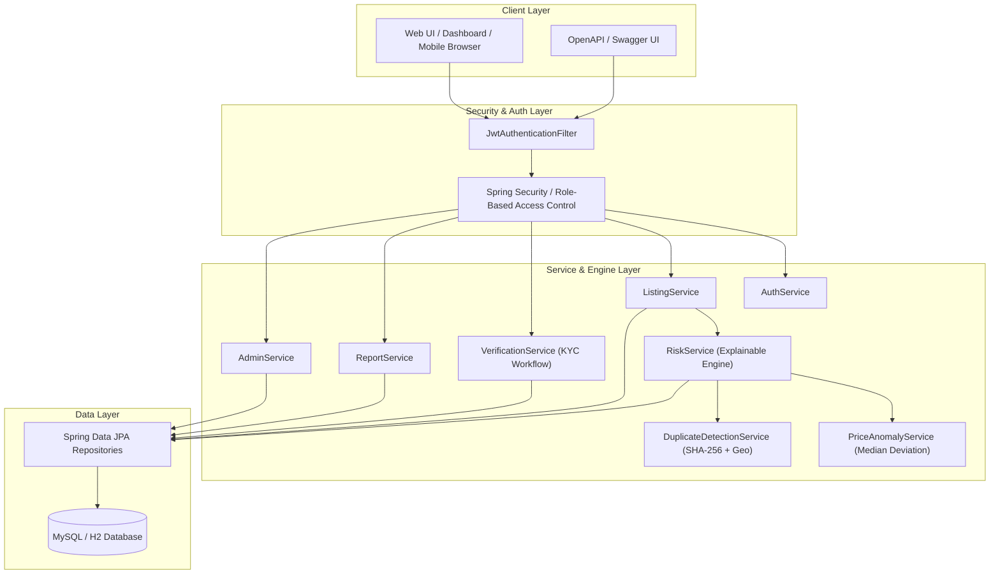

# RentGuard 🛡️
### A Risk-Aware Rental Property Verification and Scam Prevention Platform
**Java Full Stack — Complete Implementation**

[](pom.xml)
[](pom.xml)
[](pom.xml)
[](pom.xml)
[](src/main/resources/application.properties)
[](LICENSE)

---

## 1. Project Objective

**RentGuard** is a rental marketplace equipped with an explainable verification and fraud-prevention layer. While tenants search and filter rental homes, the system dynamically inspects:
1. **Owner KYC Verification**
2. **Property Ownership Verification**
3. **Price Anomaly Detection** (statistical median deviation in locality)
4. **Duplicate Property Detection** (normalized address tokenization & Haversine geo-distance)
5. **Duplicate Image Detection** (SHA-256 cryptographic image hashing)
6. **Tenant Scam Reports & Complaint History**
7. **Suspicious Rental Terms** (e.g. zero or abnormally low deposit)

These signals combine into an **explainable 0–100 risk score** with clear, transparent reasons presented to tenants and administrators.

> **Key Architectural Decision:**  
> Machine Learning / Python dependencies were deliberately omitted. Fraud scoring is powered entirely by **explainable Java rule-based and statistical algorithms**. Every single risk point is traceable to a documented rule code, point weight, and human-readable explanation.

---

## 2. Technology Stack

- **Backend:** Java 17+ (LTS) & Spring Boot 3.3.5
- **Security:** Spring Security 6 + BCrypt + Stateless JWT (HMAC-SHA256)
- **Persistence:** Spring Data JPA + Hibernate ORM
- **Database:** MySQL 8.0+ (with zero-configuration embedded H2 fallback for instant demonstration)
- **API Documentation:** SpringDoc OpenAPI 3 / Swagger UI (`/swagger-ui.html`)
- **Build System:** Apache Maven
- **Testing:** JUnit 5, Mockito, AssertJ, and Postman Collection
- **Frontend:** Responsive Web Interface (HTML5, Modern CSS, ES6 JavaScript) served directly by Spring Boot

---

## 3. System Architecture & Workflow



### End-to-End Workflow:
```
Owner registers ➔ creates property ➔ publishes listing ➔ uploads documents/images ➔ 
verification & risk engine checks ➔ listing published with risk score & audit reasons ➔ 
tenant searches ➔ views verification signals + risk breakdown ➔ tenant reports or requests visit ➔ 
admin investigates report or approves KYC ➔ risk engine dynamically recalculates scores.
```

---

## 4. Explainable Risk Detection Logic (No ML)

Each suspicious condition creates a `RiskEvent` containing a `ruleCode`, `points`, and human-readable `explanation`. The final score is the sum of applicable points, capped at 100.

| Signal Rule Code | Points | Condition & Detection Logic |
|---|---|---|
| `OWNER_UNVERIFIED` | **+20** | Owner identity is not verified by admin KYC review |
| `DOCS_MISSING_OR_REJECTED` | **+20** | Ownership proof / government ID missing or rejected |
| `PRICE_SUBSTANTIALLY_LOW` | **+25** | Rent is $\ge 35\%$ below median rent of comparable listings in the locality |
| `DUPLICATE_PROPERTY` | **+20** | Matching address similarity $\ge 85\%$ or coordinates within $150\text{ m}$ with identical BHK/type |
| `DUPLICATE_IMAGE` | **+15** | SHA-256 cryptographic hash collision found on another listing |
| `MULTIPLE_COMPLAINTS` | **+10 to +20** | 1–2 open tenant scam reports = **+10 pts**; 3+ open reports = **+20 pts** |
| `SUSPICIOUS_BEHAVIOUR` | **+10** | Abnormally low deposit ($<50\%$ rent) or newly created owner account ($<24\text{ h}$) |

### Risk Level Categorization:
- **0–29: LOW RISK (Safe)** 🟢 — Verified owner, approved documents, normal rent range, no complaints.
- **30–59: MEDIUM RISK (Caution)** 🟡 — Unverified profile or missing documentation.
- **60–100: HIGH RISK (Suspicious / Flagged)** 🔴 — Major price anomaly, duplicate photos, duplicate property, or active complaints.

---

## 5. Statistical & Algorithmic Foundations

### A. Price Anomaly Detection (Section 8)
1. Query active comparable listings matching locality, city, property type, and bedroom count (BHK).
2. Compute the **statistical median rent**:
   $$\text{Median} = \begin{cases} X_{(n+1)/2} & \text{if } n \text{ is odd} \\ \frac{X_{n/2} + X_{(n/2)+1}}{2} & \text{if } n \text{ is even} \end{cases}$$
3. Calculate percentage deviation:
   $$\text{Deviation} = \frac{|\text{listingRent} - \text{medianRent}|}{\text{medianRent}} \times 100$$
4. If $\text{listingRent} < \text{medianRent}$ and $\text{Deviation} \ge 35\%$, trigger `PRICE_SUBSTANTIALLY_LOW` (+25 points).

### B. Duplicate Property Detection (Section 9)
- **Address Normalization:** Standardizes road, street, floor, sector abbreviations, lowercases, and strips punctuation.
- **Levenshtein String Similarity:** Compares address similarity ratio ($0.0 \text{ to } 1.0$).
- **Haversine Geo-Distance:** Computes spherical distance between GPS coordinates:
  $$a = \sin^2\left(\frac{\Delta\phi}{2}\right) + \cos(\phi_1)\cos(\phi_2)\sin^2\left(\frac{\Delta\lambda}{2}\right)$$
  $$d = 2 R \cdot \text{atan2}(\sqrt{a}, \sqrt{1-a})$$
  Distance tolerance $< 150\text{ meters}$ with matching BHK/type flags duplicate listings.

### C. Duplicate Image Fingerprinting (Section 10)
- Uses `java.security.MessageDigest` to compute a deterministic **SHA-256 hexadecimal hash** (64 characters) upon image upload.
- Checks if the same SHA-256 hash exists in `property_images` for any other listing.
- Detects brokers re-uploading identical stolen photos under different property addresses.

---

## 6. Pre-Configured Demo Accounts & Scenarios

The platform automatically bootstraps realistic demo scenarios via `DataInitializer`:

| Role | Email | Password | Pre-Loaded State & Characteristics |
|---|---|---|---|
| **Platform Admin** | `admin@rentguard.com` | `Password123!` | Full moderation, analytics, KYC approval, suspension privileges |
| **Verified Owner** | `owner@rentguard.com` | `Password123!` | **Rahul Verma** (KYC Verified, Trust Score 95, approved documents) |
| **Suspicious Owner** | `vikram@rentguard.com` | `Password123!` | **Vikram Singh** (Unverified, pending KYC, duplicate listing) |
| **Tenant** | `tenant@rentguard.com` | `Password123!` | **Priya Sharma** (Can search, request visits, file scam reports) |

### Pre-Loaded Test Listings:
1. **Listing #1 (Sector 62, Noida):** ₹18,000/mo (2 BHK). Verified owner, approved KYC. **Risk: 22/100 (LOW)**.
2. **Listing #2 (Sector 62, Noida):** ₹20,000/mo (2 BHK). Verified owner. **Risk: 22/100 (LOW)**.
3. **Listing #4 (Sector 62, Noida — Price Scam):** ₹6,500/mo (65% below median). 2 active scam complaints filed. **Risk: 85/100 (HIGH)**.
4. **Listing #5 (Sector 62, Noida — Stolen Photos):** Reuses Listing #1's SHA-256 image hash & duplicate address. **Risk: 75/100 (HIGH)**.

---

## 7. Running the Application

### Option A: 1-Click Run with Maven (Embedded H2 Database — Zero Setup)
```bash
# Clone and enter directory
cd RentGuard

# Run the Spring Boot application (Default profile uses H2 in-memory DB)
mvn spring-boot:run
```
Once booted, open your browser:
- **Web App:** [http://localhost:8080](http://localhost:8080)
- **Interactive Swagger REST API Docs:** [http://localhost:8080/swagger-ui.html](http://localhost:8080/swagger-ui.html)
- **H2 Database Console:** [http://localhost:8080/h2-console](http://localhost:8080/h2-console) (JDBC URL: `jdbc:h2:mem:rentguard`, User: `sa`, Password: empty)

---

### Option B: Running with Local MySQL
1. Make sure MySQL is running on port 3306.
2. Run with the MySQL Spring profile:
```bash
mvn spring-boot:run -Dspring-boot.run.profiles=mysql
```
Or set environment variables:
```bash
export DB_URL="jdbc:mysql://localhost:3306/rentguard?createDatabaseIfNotExist=true&useSSL=false&allowPublicKeyRetrieval=true&serverTimezone=UTC"
export DB_USERNAME="root"
export DB_PASSWORD="your_password"
mvn spring-boot:run -Dspring-boot.run.profiles=mysql
```

---

### Option C: Running with Docker Compose (MySQL + App)
```bash
docker-compose up --build
```

---

## 8. Executing Automated Tests

All unit and integration tests run inside standard JUnit 5 & Mockito test suites:
```bash
mvn test
```
**Test coverage highlights:**
- `PriceAnomalyServiceTest`: Verifies 50% under-price anomaly detection vs. normal prices.
- `DuplicateDetectionServiceTest`: Verifies address normalization, Levenshtein distance, Haversine geo-distance, and SHA-256 image hashing.
- `RiskServiceTest`: Validates end-to-end score calculation for low-risk and high-risk scam listings.
- `AuthServiceTest`: Validates BCrypt hashing, duplicate email rejection, and JWT token issuance.

---

## 9. REST API Reference

| HTTP Method | Endpoint | Authorization | Description |
|---|---|---|---|
| `POST` | `/api/auth/register` | Public | Register new Tenant, Owner, or Admin |
| `POST` | `/api/auth/login` | Public | Authenticate user and receive JWT bearer token |
| `GET` | `/api/auth/me` | Authenticated | Retrieve authenticated user profile |
| `GET` | `/api/listings` | Public | Search listings with filters (city, BHK, maxRisk) |
| `GET` | `/api/listings/{id}` | Public | Get listing details + full explainable risk breakdown |
| `POST` | `/api/listings` | Owner / Admin | Create listing & trigger immediate risk engine |
| `PUT` | `/api/listings/{id}` | Owner / Admin | Update listing attributes and re-evaluate risk |
| `POST` | `/api/listings/{id}/images`| Owner / Admin | Upload property image (computes SHA-256 hash) |
| `POST` | `/api/listings/{id}/report`| Tenant | Report suspicious listing with scam reason |
| `POST` | `/api/listings/{id}/review`| Tenant | Submit rating (1–5) and review |
| `POST` | `/api/listings/{id}/visits`| Tenant | Schedule a property visit |
| `POST` | `/api/verification/submit` | Owner | Submit owner KYC or property proof document |
| `GET` | `/api/admin/verifications` | Admin Only | Get pending KYC verification queue |
| `PUT` | `/api/admin/verifications/{id}`| Admin Only | 1-Click Approve / Reject verification document |
| `GET` | `/api/admin/reports` | Admin Only | Get tenant scam reports queue |
| `PUT` | `/api/admin/reports/{id}` | Admin Only | Resolve or dismiss scam report |
| `PUT` | `/api/admin/listings/{id}/suspend` | Admin Only | Suspend fraudulent listing |
| `GET` | `/api/admin/analytics` | Admin Only | Get fraud metrics & risk score distributions |
| `GET` | `/api/admin/audit-logs` | Admin Only | View system security and admin audit logs |

---

## 10. Viva & Academic Defense Guide (Section 26)

### Viva Explanation:
> *"RentGuard is a Java Full Stack rental platform that adds an explainable scam-prevention layer to normal property search. Instead of opaque machine learning models, the system uses explainable business rules and statistical comparisons. It verifies owners and properties, detects suspicious pricing and duplicates, collects user reports, and combines these signals into a transparent risk score. An admin dashboard lets company moderators investigate high-risk listings and manage verification queues."*

### Key Viva Questions & Answers:
1. **Why rule-based fraud detection over Machine Learning?**  
   *Answer:* In property marketplaces, tenants and landlords demand explainability. If a listing is flagged as high-risk, RentGuard explicitly states why (e.g., *"+25 pts: Rent is 50% below locality median"*, *"+15 pts: Duplicate photo detected"*). ML models can behave as black boxes and require thousands of labeled scam samples that are difficult to gather in regional rental markets.
2. **How does duplicate image detection work?**  
   *Answer:* When an image is uploaded, Java's `MessageDigest` calculates its 256-bit cryptographic hash (SHA-256). We store this in the database and check if the same hash appears under any other listing.
3. **How is price anomaly calculated?**  
   *Answer:* We filter comparable properties in the same locality, city, and bedroom count (BHK), calculate the statistical median rent, and measure percentage deviation. An under-price deviation of $\ge 35\%$ triggers the price anomaly signal.
4. **How are passwords and APIs secured?**  
   *Answer:* Passwords are encrypted using BCrypt with salt rounds. REST APIs are protected via stateless JWT tokens with role-based authorization (`ROLE_TENANT`, `ROLE_OWNER`, `ROLE_ADMIN`).
